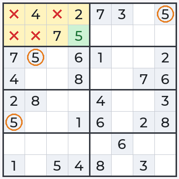

<!-- Written by tools/walkthrough.py mini-8x8: edit the script, not this page. -->
# Mini 8x8, step 1: the 5 in box 1

**Step 1 of 34** · [← The start](../mini-8x8.md#the-whole-puzzle-step-by-step) · [All steps](../mini-8x8.md#the-whole-puzzle-step-by-step) · [Step 2 →](step-02.md)

Box 1 needs a 5. r1c1 and r1c3: row 1 has one (r1c8). r2c1: column 1 has one (r6c1). r2c2: column 2 has one (r3c2). Only **r2c4** is left: **r2c4 = 5**.

**Step 1 of 34** · [← The start](../mini-8x8.md#the-whole-puzzle-step-by-step) · [All steps](../mini-8x8.md#the-whole-puzzle-step-by-step) · [Step 2 →](step-02.md)
