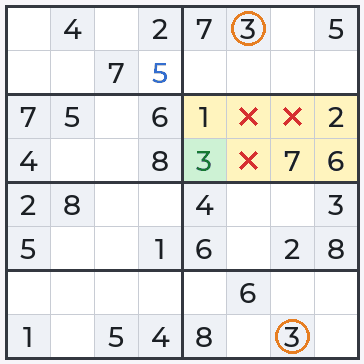

<!-- Written by tools/walkthrough.py mini-8x8: edit the script, not this page. -->
# Mini 8x8, step 2: the 3 in box 4

**Step 2 of 34** · [← Step 1](step-01.md) · [All steps](../mini-8x8.md#the-whole-puzzle-step-by-step) · [Step 3 →](step-03.md)

Box 4 needs a 3. r3c6 and r4c6: column 6 has one (r1c6). r3c7: column 7 has one (r8c7). Only **r4c5** is left: **r4c5 = 3**.

**Step 2 of 34** · [← Step 1](step-01.md) · [All steps](../mini-8x8.md#the-whole-puzzle-step-by-step) · [Step 3 →](step-03.md)
