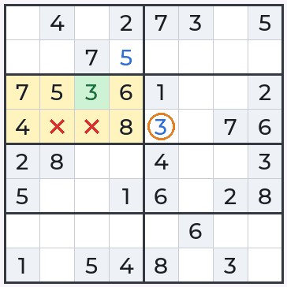

<!-- Written by tools/walkthrough.py mini-8x8: edit the script, not this page. -->
# Mini 8x8, step 3: the 3 in box 3

**Step 3 of 34** · [← Step 2](step-02.md) · [All steps](../mini-8x8.md#the-whole-puzzle-step-by-step) · [Step 4 →](step-04.md)

Box 3 needs a 3. r4c2 and r4c3: row 4 has one (r4c5). Only **r3c3** is left: **r3c3 = 3**.

**Step 3 of 34** · [← Step 2](step-02.md) · [All steps](../mini-8x8.md#the-whole-puzzle-step-by-step) · [Step 4 →](step-04.md)
