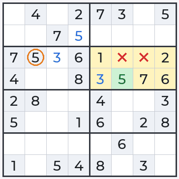

<!-- Written by tools/walkthrough.py mini-8x8: edit the script, not this page. -->
# Mini 8x8, step 4: the 5 in box 4

**Step 4 of 34** · [← Step 3](step-03.md) · [All steps](../mini-8x8.md#the-whole-puzzle-step-by-step) · [Step 5 →](step-05.md)

Box 4 needs a 5. r3c6 and r3c7: row 3 has one (r3c2). Only **r4c6** is left: **r4c6 = 5**.

**Step 4 of 34** · [← Step 3](step-03.md) · [All steps](../mini-8x8.md#the-whole-puzzle-step-by-step) · [Step 5 →](step-05.md)
