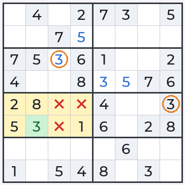

<!-- Written by tools/walkthrough.py mini-8x8: edit the script, not this page. -->
# Mini 8x8, step 5: the 3 in box 5

**Step 5 of 34** · [← Step 4](step-04.md) · [All steps](../mini-8x8.md#the-whole-puzzle-step-by-step) · [Step 6 →](step-06.md)

Box 5 needs a 3. r5c3 and r5c4: row 5 has one (r5c8). r6c3: column 3 has one (r3c3). Only **r6c2** is left: **r6c2 = 3**.

**Step 5 of 34** · [← Step 4](step-04.md) · [All steps](../mini-8x8.md#the-whole-puzzle-step-by-step) · [Step 6 →](step-06.md)
