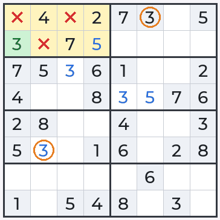

<!-- Written by tools/walkthrough.py mini-8x8: edit the script, not this page. -->
# Mini 8x8, step 6: the 3 in box 1

**Step 6 of 34** · [← Step 5](step-05.md) · [All steps](../mini-8x8.md#the-whole-puzzle-step-by-step) · [Step 7 →](step-07.md)

Box 1 needs a 3. r1c1 and r1c3: row 1 has one (r1c6). r2c2: column 2 has one (r6c2). Only **r2c1** is left: **r2c1 = 3**.

**Step 6 of 34** · [← Step 5](step-05.md) · [All steps](../mini-8x8.md#the-whole-puzzle-step-by-step) · [Step 7 →](step-07.md)
