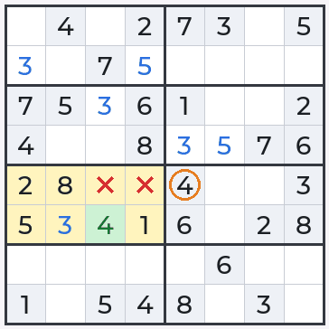

<!-- Written by tools/walkthrough.py mini-8x8: edit the script, not this page. -->
# Mini 8x8, step 7: the 4 in box 5

**Step 7 of 34** · [← Step 6](step-06.md) · [All steps](../mini-8x8.md#the-whole-puzzle-step-by-step) · [Step 8 →](step-08.md)

Box 5 needs a 4. r5c3 and r5c4: row 5 has one (r5c5). Only **r6c3** is left: **r6c3 = 4**.

**Step 7 of 34** · [← Step 6](step-06.md) · [All steps](../mini-8x8.md#the-whole-puzzle-step-by-step) · [Step 8 →](step-08.md)
