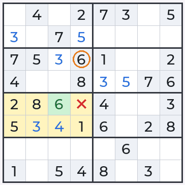

<!-- Written by tools/walkthrough.py mini-8x8: edit the script, not this page. -->
# Mini 8x8, step 8: the 6 in box 5

**Step 8 of 34** · [← Step 7](step-07.md) · [All steps](../mini-8x8.md#the-whole-puzzle-step-by-step) · [Step 9 →](step-09.md)

Box 5 needs a 6. r5c4: column 4 has one (r3c4). Only **r5c3** is left: **r5c3 = 6**.

**Step 8 of 34** · [← Step 7](step-07.md) · [All steps](../mini-8x8.md#the-whole-puzzle-step-by-step) · [Step 9 →](step-09.md)
