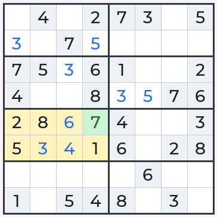

<!-- Written by tools/walkthrough.py mini-8x8: edit the script, not this page. -->
# Mini 8x8, step 9: the 7 in box 5

**Step 9 of 34** · [← Step 8](step-08.md) · [All steps](../mini-8x8.md#the-whole-puzzle-step-by-step) · [Step 10 →](step-10.md)

Box 5 needs a 7, and r5c4 is its last empty cell: **r5c4 = 7**.

**Step 9 of 34** · [← Step 8](step-08.md) · [All steps](../mini-8x8.md#the-whole-puzzle-step-by-step) · [Step 10 →](step-10.md)
