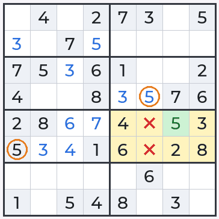

<!-- Written by tools/walkthrough.py mini-8x8: edit the script, not this page. -->
# Mini 8x8, step 10: the 5 in box 6

**Step 10 of 34** · [← Step 9](step-09.md) · [All steps](../mini-8x8.md#the-whole-puzzle-step-by-step) · [Step 11 →](step-11.md)

Box 6 needs a 5. r5c6: column 6 has one (r4c6). r6c6: row 6 has one (r6c1). Only **r5c7** is left: **r5c7 = 5**.

**Step 10 of 34** · [← Step 9](step-09.md) · [All steps](../mini-8x8.md#the-whole-puzzle-step-by-step) · [Step 11 →](step-11.md)
