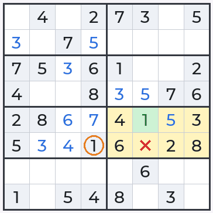

<!-- Written by tools/walkthrough.py mini-8x8: edit the script, not this page. -->
# Mini 8x8, step 11: the 1 in box 6

**Step 11 of 34** · [← Step 10](step-10.md) · [All steps](../mini-8x8.md#the-whole-puzzle-step-by-step) · [Step 12 →](step-12.md)

Box 6 needs a 1. r6c6: row 6 has one (r6c4). Only **r5c6** is left: **r5c6 = 1**.

**Step 11 of 34** · [← Step 10](step-10.md) · [All steps](../mini-8x8.md#the-whole-puzzle-step-by-step) · [Step 12 →](step-12.md)
