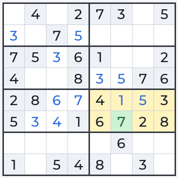

<!-- Written by tools/walkthrough.py mini-8x8: edit the script, not this page. -->
# Mini 8x8, step 12: the 7 in box 6

**Step 12 of 34** · [← Step 11](step-11.md) · [All steps](../mini-8x8.md#the-whole-puzzle-step-by-step) · [Step 13 →](step-13.md)

Box 6 needs a 7, and r6c6 is its last empty cell: **r6c6 = 7**.

**Step 12 of 34** · [← Step 11](step-11.md) · [All steps](../mini-8x8.md#the-whole-puzzle-step-by-step) · [Step 13 →](step-13.md)
