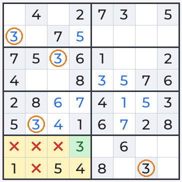

<!-- Written by tools/walkthrough.py mini-8x8: edit the script, not this page. -->
# Mini 8x8, step 13: the 3 in box 7

**Step 13 of 34** · [← Step 12](step-12.md) · [All steps](../mini-8x8.md#the-whole-puzzle-step-by-step) · [Step 14 →](step-14.md)

Box 7 needs a 3. r7c1: column 1 has one (r2c1). r7c2: column 2 has one (r6c2). r7c3: column 3 has one (r3c3). r8c2: row 8 has one (r8c7). Only **r7c4** is left: **r7c4 = 3**.

**Step 13 of 34** · [← Step 12](step-12.md) · [All steps](../mini-8x8.md#the-whole-puzzle-step-by-step) · [Step 14 →](step-14.md)
