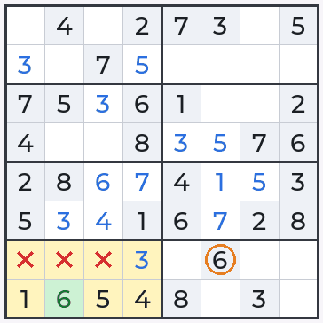

<!-- Written by tools/walkthrough.py mini-8x8: edit the script, not this page. -->
# Mini 8x8, step 14: the 6 in box 7

**Step 14 of 34** · [← Step 13](step-13.md) · [All steps](../mini-8x8.md#the-whole-puzzle-step-by-step) · [Step 15 →](step-15.md)

Box 7 needs a 6. r7c1, r7c2 and r7c3: row 7 has one (r7c6). Only **r8c2** is left: **r8c2 = 6**.

**Step 14 of 34** · [← Step 13](step-13.md) · [All steps](../mini-8x8.md#the-whole-puzzle-step-by-step) · [Step 15 →](step-15.md)
