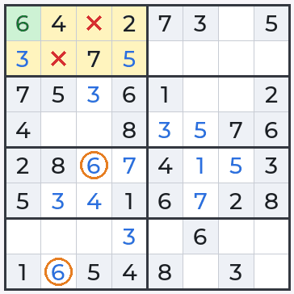

<!-- Written by tools/walkthrough.py mini-8x8: edit the script, not this page. -->
# Mini 8x8, step 15: the 6 in box 1

**Step 15 of 34** · [← Step 14](step-14.md) · [All steps](../mini-8x8.md#the-whole-puzzle-step-by-step) · [Step 16 →](step-16.md)

Box 1 needs a 6. r1c3: column 3 has one (r5c3). r2c2: column 2 has one (r8c2). Only **r1c1** is left: **r1c1 = 6**.

**Step 15 of 34** · [← Step 14](step-14.md) · [All steps](../mini-8x8.md#the-whole-puzzle-step-by-step) · [Step 16 →](step-16.md)
