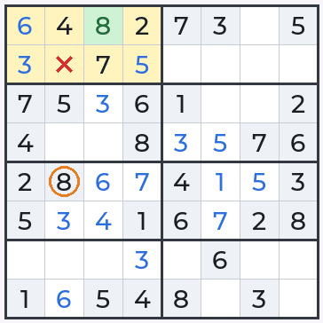

<!-- Written by tools/walkthrough.py mini-8x8: edit the script, not this page. -->
# Mini 8x8, step 16: the 8 in box 1

**Step 16 of 34** · [← Step 15](step-15.md) · [All steps](../mini-8x8.md#the-whole-puzzle-step-by-step) · [Step 17 →](step-17.md)

Box 1 needs an 8. r2c2: column 2 has one (r5c2). Only **r1c3** is left: **r1c3 = 8**.

**Step 16 of 34** · [← Step 15](step-15.md) · [All steps](../mini-8x8.md#the-whole-puzzle-step-by-step) · [Step 17 →](step-17.md)
