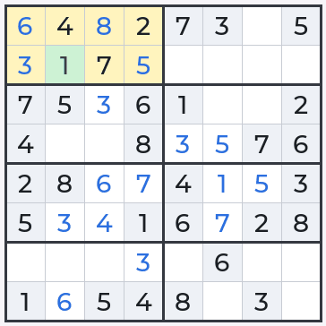

<!-- Written by tools/walkthrough.py mini-8x8: edit the script, not this page. -->
# Mini 8x8, step 17: the 1 in box 1

**Step 17 of 34** · [← Step 16](step-16.md) · [All steps](../mini-8x8.md#the-whole-puzzle-step-by-step) · [Step 18 →](step-18.md)

Box 1 needs a 1, and r2c2 is its last empty cell: **r2c2 = 1**.

**Step 17 of 34** · [← Step 16](step-16.md) · [All steps](../mini-8x8.md#the-whole-puzzle-step-by-step) · [Step 18 →](step-18.md)
