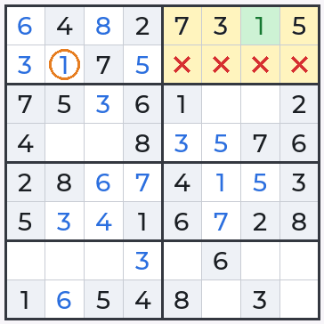

<!-- Written by tools/walkthrough.py mini-8x8: edit the script, not this page. -->
# Mini 8x8, step 18: the 1 in box 2

**Step 18 of 34** · [← Step 17](step-17.md) · [All steps](../mini-8x8.md#the-whole-puzzle-step-by-step) · [Step 19 →](step-19.md)

Box 2 needs a 1. r2c5, r2c6, r2c7 and r2c8: row 2 has one (r2c2). Only **r1c7** is left: **r1c7 = 1**.

**Step 18 of 34** · [← Step 17](step-17.md) · [All steps](../mini-8x8.md#the-whole-puzzle-step-by-step) · [Step 19 →](step-19.md)
