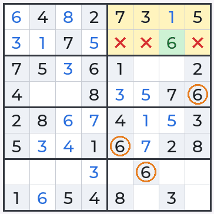

<!-- Written by tools/walkthrough.py mini-8x8: edit the script, not this page. -->
# Mini 8x8, step 19: the 6 in box 2

**Step 19 of 34** · [← Step 18](step-18.md) · [All steps](../mini-8x8.md#the-whole-puzzle-step-by-step) · [Step 20 →](step-20.md)

Box 2 needs a 6. r2c5: column 5 has one (r6c5). r2c6: column 6 has one (r7c6). r2c8: column 8 has one (r4c8). Only **r2c7** is left: **r2c7 = 6**.

**Step 19 of 34** · [← Step 18](step-18.md) · [All steps](../mini-8x8.md#the-whole-puzzle-step-by-step) · [Step 20 →](step-20.md)
