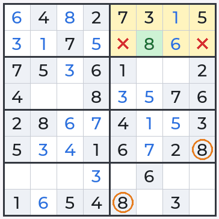

<!-- Written by tools/walkthrough.py mini-8x8: edit the script, not this page. -->
# Mini 8x8, step 20: the 8 in box 2

**Step 20 of 34** · [← Step 19](step-19.md) · [All steps](../mini-8x8.md#the-whole-puzzle-step-by-step) · [Step 21 →](step-21.md)

Box 2 needs an 8. r2c5: column 5 has one (r8c5). r2c8: column 8 has one (r6c8). Only **r2c6** is left: **r2c6 = 8**.

**Step 20 of 34** · [← Step 19](step-19.md) · [All steps](../mini-8x8.md#the-whole-puzzle-step-by-step) · [Step 21 →](step-21.md)
