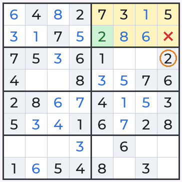

<!-- Written by tools/walkthrough.py mini-8x8: edit the script, not this page. -->
# Mini 8x8, step 21: the 2 in box 2

**Step 21 of 34** · [← Step 20](step-20.md) · [All steps](../mini-8x8.md#the-whole-puzzle-step-by-step) · [Step 22 →](step-22.md)

Box 2 needs a 2. r2c8: column 8 has one (r3c8). Only **r2c5** is left: **r2c5 = 2**.

**Step 21 of 34** · [← Step 20](step-20.md) · [All steps](../mini-8x8.md#the-whole-puzzle-step-by-step) · [Step 22 →](step-22.md)
