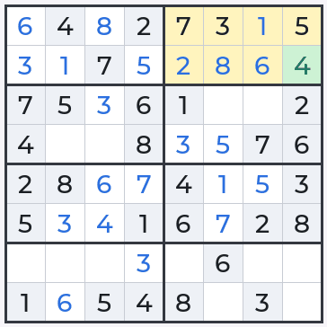

<!-- Written by tools/walkthrough.py mini-8x8: edit the script, not this page. -->
# Mini 8x8, step 22: the 4 in box 2

**Step 22 of 34** · [← Step 21](step-21.md) · [All steps](../mini-8x8.md#the-whole-puzzle-step-by-step) · [Step 23 →](step-23.md)

Box 2 needs a 4, and r2c8 is its last empty cell: **r2c8 = 4**.

**Step 22 of 34** · [← Step 21](step-21.md) · [All steps](../mini-8x8.md#the-whole-puzzle-step-by-step) · [Step 23 →](step-23.md)
