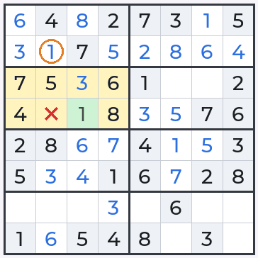

<!-- Written by tools/walkthrough.py mini-8x8: edit the script, not this page. -->
# Mini 8x8, step 23: the 1 in box 3

**Step 23 of 34** · [← Step 22](step-22.md) · [All steps](../mini-8x8.md#the-whole-puzzle-step-by-step) · [Step 24 →](step-24.md)

Box 3 needs a 1. r4c2: column 2 has one (r2c2). Only **r4c3** is left: **r4c3 = 1**.

**Step 23 of 34** · [← Step 22](step-22.md) · [All steps](../mini-8x8.md#the-whole-puzzle-step-by-step) · [Step 24 →](step-24.md)
