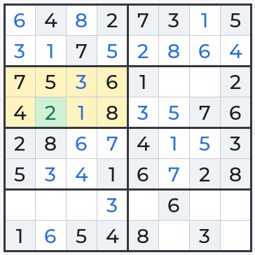

<!-- Written by tools/walkthrough.py mini-8x8: edit the script, not this page. -->
# Mini 8x8, step 24: the 2 in box 3

**Step 24 of 34** · [← Step 23](step-23.md) · [All steps](../mini-8x8.md#the-whole-puzzle-step-by-step) · [Step 25 →](step-25.md)

Box 3 needs a 2, and r4c2 is its last empty cell: **r4c2 = 2**.

**Step 24 of 34** · [← Step 23](step-23.md) · [All steps](../mini-8x8.md#the-whole-puzzle-step-by-step) · [Step 25 →](step-25.md)
