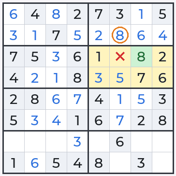

<!-- Written by tools/walkthrough.py mini-8x8: edit the script, not this page. -->
# Mini 8x8, step 25: the 8 in box 4

**Step 25 of 34** · [← Step 24](step-24.md) · [All steps](../mini-8x8.md#the-whole-puzzle-step-by-step) · [Step 26 →](step-26.md)

Box 4 needs an 8. r3c6: column 6 has one (r2c6). Only **r3c7** is left: **r3c7 = 8**.

**Step 25 of 34** · [← Step 24](step-24.md) · [All steps](../mini-8x8.md#the-whole-puzzle-step-by-step) · [Step 26 →](step-26.md)
