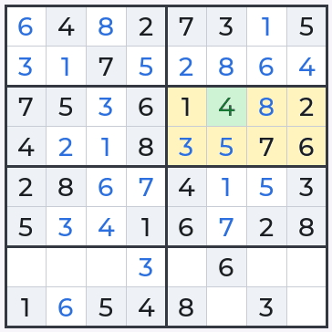

<!-- Written by tools/walkthrough.py mini-8x8: edit the script, not this page. -->
# Mini 8x8, step 26: the 4 in box 4

**Step 26 of 34** · [← Step 25](step-25.md) · [All steps](../mini-8x8.md#the-whole-puzzle-step-by-step) · [Step 27 →](step-27.md)

Box 4 needs a 4, and r3c6 is its last empty cell: **r3c6 = 4**.

**Step 26 of 34** · [← Step 25](step-25.md) · [All steps](../mini-8x8.md#the-whole-puzzle-step-by-step) · [Step 27 →](step-27.md)
