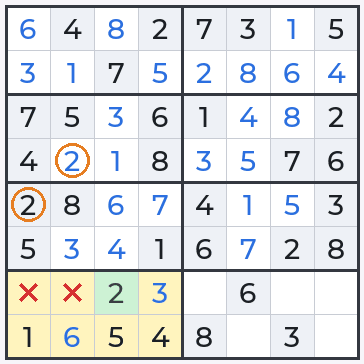

<!-- Written by tools/walkthrough.py mini-8x8: edit the script, not this page. -->
# Mini 8x8, step 27: the 2 in box 7

**Step 27 of 34** · [← Step 26](step-26.md) · [All steps](../mini-8x8.md#the-whole-puzzle-step-by-step) · [Step 28 →](step-28.md)

Box 7 needs a 2. r7c1: column 1 has one (r5c1). r7c2: column 2 has one (r4c2). Only **r7c3** is left: **r7c3 = 2**.

**Step 27 of 34** · [← Step 26](step-26.md) · [All steps](../mini-8x8.md#the-whole-puzzle-step-by-step) · [Step 28 →](step-28.md)
