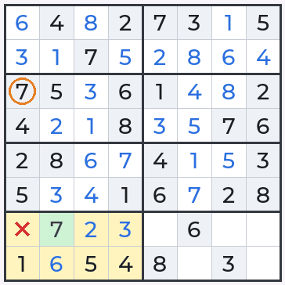

<!-- Written by tools/walkthrough.py mini-8x8: edit the script, not this page. -->
# Mini 8x8, step 28: the 7 in box 7

**Step 28 of 34** · [← Step 27](step-27.md) · [All steps](../mini-8x8.md#the-whole-puzzle-step-by-step) · [Step 29 →](step-29.md)

Box 7 needs a 7. r7c1: column 1 has one (r3c1). Only **r7c2** is left: **r7c2 = 7**.

**Step 28 of 34** · [← Step 27](step-27.md) · [All steps](../mini-8x8.md#the-whole-puzzle-step-by-step) · [Step 29 →](step-29.md)
