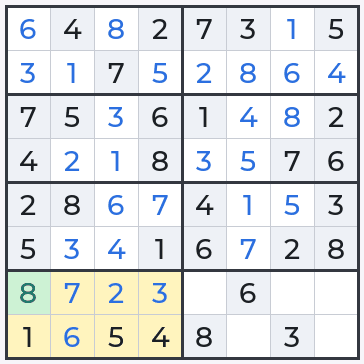

<!-- Written by tools/walkthrough.py mini-8x8: edit the script, not this page. -->
# Mini 8x8, step 29: the 8 in box 7

**Step 29 of 34** · [← Step 28](step-28.md) · [All steps](../mini-8x8.md#the-whole-puzzle-step-by-step) · [Step 30 →](step-30.md)

Box 7 needs an 8, and r7c1 is its last empty cell: **r7c1 = 8**.

**Step 29 of 34** · [← Step 28](step-28.md) · [All steps](../mini-8x8.md#the-whole-puzzle-step-by-step) · [Step 30 →](step-30.md)
