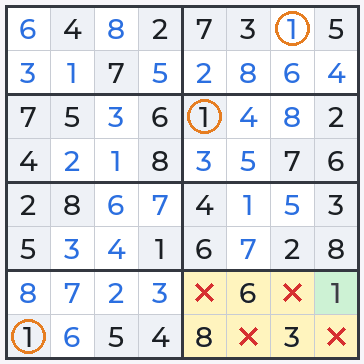

<!-- Written by tools/walkthrough.py mini-8x8: edit the script, not this page. -->
# Mini 8x8, step 30: the 1 in box 8

**Step 30 of 34** · [← Step 29](step-29.md) · [All steps](../mini-8x8.md#the-whole-puzzle-step-by-step) · [Step 31 →](step-31.md)

Box 8 needs a 1. r7c5: column 5 has one (r3c5). r7c7: column 7 has one (r1c7). r8c6 and r8c8: row 8 has one (r8c1). Only **r7c8** is left: **r7c8 = 1**.

**Step 30 of 34** · [← Step 29](step-29.md) · [All steps](../mini-8x8.md#the-whole-puzzle-step-by-step) · [Step 31 →](step-31.md)
