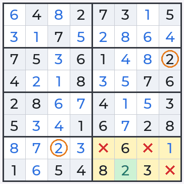

<!-- Written by tools/walkthrough.py mini-8x8: edit the script, not this page. -->
# Mini 8x8, step 31: the 2 in box 8

**Step 31 of 34** · [← Step 30](step-30.md) · [All steps](../mini-8x8.md#the-whole-puzzle-step-by-step) · [Step 32 →](step-32.md)

Box 8 needs a 2. r7c5 and r7c7: row 7 has one (r7c3). r8c8: column 8 has one (r3c8). Only **r8c6** is left: **r8c6 = 2**.

**Step 31 of 34** · [← Step 30](step-30.md) · [All steps](../mini-8x8.md#the-whole-puzzle-step-by-step) · [Step 32 →](step-32.md)
