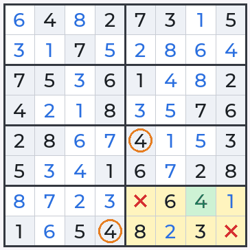

<!-- Written by tools/walkthrough.py mini-8x8: edit the script, not this page. -->
# Mini 8x8, step 32: the 4 in box 8

**Step 32 of 34** · [← Step 31](step-31.md) · [All steps](../mini-8x8.md#the-whole-puzzle-step-by-step) · [Step 33 →](step-33.md)

Box 8 needs a 4. r7c5: column 5 has one (r5c5). r8c8: row 8 has one (r8c4). Only **r7c7** is left: **r7c7 = 4**.

**Step 32 of 34** · [← Step 31](step-31.md) · [All steps](../mini-8x8.md#the-whole-puzzle-step-by-step) · [Step 33 →](step-33.md)
