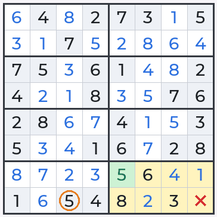

<!-- Written by tools/walkthrough.py mini-8x8: edit the script, not this page. -->
# Mini 8x8, step 33: the 5 in box 8

**Step 33 of 34** · [← Step 32](step-32.md) · [All steps](../mini-8x8.md#the-whole-puzzle-step-by-step) · [Step 34 →](step-34.md)

Box 8 needs a 5. r8c8: row 8 has one (r8c3). Only **r7c5** is left: **r7c5 = 5**.

**Step 33 of 34** · [← Step 32](step-32.md) · [All steps](../mini-8x8.md#the-whole-puzzle-step-by-step) · [Step 34 →](step-34.md)
