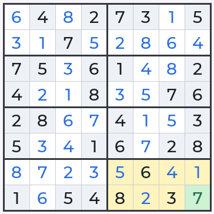

<!-- Written by tools/walkthrough.py mini-8x8: edit the script, not this page. -->
# Mini 8x8, step 34: the 7 in box 8

**Step 34 of 34** · [← Step 33](step-33.md) · [All steps](../mini-8x8.md#the-whole-puzzle-step-by-step) · [All steps](../mini-8x8.md#the-whole-puzzle-step-by-step)

Box 8 needs a 7, and r8c8 is its last empty cell: **r8c8 = 7**.

Solved.

**Step 34 of 34** · [← Step 33](step-33.md) · [All steps](../mini-8x8.md#the-whole-puzzle-step-by-step) · [All steps](../mini-8x8.md#the-whole-puzzle-step-by-step)
