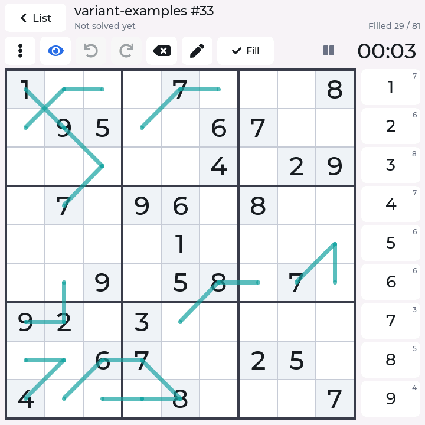
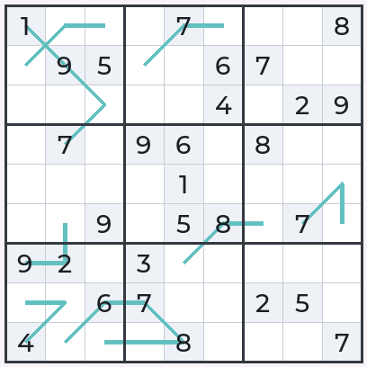

# Modular Lines

[← All variants](README.md) · [Puzzles](../features-puzzles.md) · [How to play](../how-to-play.md)

## The rules

[Classic](classic.md) rules, plus **teal lines** through cells side by side or diagonal. The digits fall into three groups by their remainder when divided by 3: **1 4 7**, **2 5 8** and **3 6 9**. **Any three cells in a row on a line hold one digit of each group**, in any order: 1, 5, 3, 7, 2 works, since 1 5 3, 5 3 7 and 3 7 2 each have one of 1 4 7, one of 2 5 8 and one of 3 6 9.

As with [Entropic Lines](entropic-lines.md), **cells three apart on a line are in the same group**: on 1, 5, 3, 7, 2 the 1 and the 7 are both of 1 4 7.

## On the board

- Each line is a narrow teal line under the digits.
- Two digits on a line that break the rule turn red: three apart in different groups, or closer together in the same group.
- The grader and hints work out, for each third of the line, which groups it can still be, and give the thirds three different groups: "Any three cells in a row on this line hold one of 1 4 7, one of 2 5 8 and one of 3 6 9, so ...".
- **Puzzles → ⋮ → New puzzle → Lines → Modular**: 8 lines (Hard and Expert 10) of 3 to 8 cells.

## How to solve it

- **Every third cell matches:** once a cell's group is known, so is the group of every cell 3, 6 ... along from it.
- **Two groups known, the third follows:** next to a 4 and a 9 on a line, the third cell is 2, 5 or 8.
- **The groups cut across low and high:** each holds a low, a middle and a high digit, so a group alone never says "big" or "small"; rows, columns and boxes pick the digit.

## Worked example

**variant-examples #33**, Modular Lines Easy (see [Classic](classic.md#worked-example-the-whole-puzzle) for how to import the examples; cells are written r*row*c*column*). The lines are in the screenshot; three matter here:

- a line of **three**: r6c2, r5c3 (an 8) and r4c4;
- a line of **five**: r7c1, r8c1, r8c2, r7c2 and r8c3 (a 1);
- another line of **five**: r7c6, r6c6, r6c5, r5c4 (a 6) and r5c5 (a 7).

**Step 1: r4c4, on the line of three.** Row 4 has 1 and 7; column 4 has 2, 5, 6 and 9; box 5 has 4: that leaves 3 and 8. The line's three cells hold one of each group, and r5c3's 8 is the line's 2 5 8. **r4c4 = 3**.

**Step 2: r8c2, the 3rd cell of the first line of five.** Row 8 has 1, 3, 5 and 6; column 2 has 2, 7 and 8: that leaves 4 and 9. Two cells along is r8c3, a 1, in the same three-in-a-row: r8c2 can't be of 1 4 7 too. **r8c2 = 9**.

**Step 3: r6c6, the 2nd cell of the other line of five.** Row 6 has 3 and 7; column 6 has 4, 5, 6 and 9: that leaves 1, 2 and 8. Three cells along is its 5th, r5c5, a 7: of 1 4 7. **r6c6 = 1**.

## The whole puzzle, step by step

<!-- walkthrough -->
<!-- Written by tools/walkthrough.py modular-lines: edit the script, not this part. -->

The whole puzzle, from the start to the last cell: 52 steps, each one a single (one place left for a digit, or one digit left for a cell), taken in the order a box's single comes first, so not quite the order of the worked example above. Each step has a page of its own, with **Previous** and **Next**: pick one from the list below. In each picture, the unit the step looks at is tinted yellow (for a cell with one digit left: its row, column and box), the new digit is on green, the digits that rule cells out have an **orange ring**, and the empty cells they rule out a **red cross**. Givens are on grey, digits from earlier steps in blue.

1. [the 9 in box 1](modular-lines/step-01.md)
2. [the 9 in box 3](modular-lines/step-02.md)
3. [the 9 in box 5](modular-lines/step-03.md)
4. [the 3 in box 5](modular-lines/step-04.md)
5. [the 9 in box 4](modular-lines/step-05.md)
6. [the 5 in box 5](modular-lines/step-06.md)
7. [the 2 in box 5](modular-lines/step-07.md)
8. [the 8 in box 5](modular-lines/step-08.md)
9. [the 1 in box 5](modular-lines/step-09.md)
10. [the 1 in box 4](modular-lines/step-10.md)
11. [the 1 in box 1](modular-lines/step-11.md)
12. [the 3 in box 1](modular-lines/step-12.md)
13. [the 6 in box 1](modular-lines/step-13.md)
14. [the 6 in box 2](modular-lines/step-14.md)
15. [the 6 in box 4](modular-lines/step-15.md)
16. [the 5 in box 4](modular-lines/step-16.md)
17. [the 4 in box 4](modular-lines/step-17.md)
18. [the 2 in box 6](modular-lines/step-18.md)
19. [the 2 in box 3](modular-lines/step-19.md)
20. [the 4 in box 6](modular-lines/step-20.md)
21. [the 5 in box 6](modular-lines/step-21.md)
22. [the 5 in box 3](modular-lines/step-22.md)
23. [the 1 in box 3](modular-lines/step-23.md)
24. [the 1 in box 2](modular-lines/step-24.md)
25. [the 7 in box 2](modular-lines/step-25.md)
26. [the 7 in box 3](modular-lines/step-26.md)
27. [the 4 in box 3](modular-lines/step-27.md)
28. [the 4 in box 2](modular-lines/step-28.md)
29. [the 3 in box 3](modular-lines/step-29.md)
30. [the 8 in box 3](modular-lines/step-30.md)
31. [the 6 in box 6](modular-lines/step-31.md)
32. [the 8 in box 6](modular-lines/step-32.md)
33. [the 2 in box 7](modular-lines/step-33.md)
34. [the 5 in box 7](modular-lines/step-34.md)
35. [the 3 in box 7](modular-lines/step-35.md)
36. [the 6 in box 7](modular-lines/step-36.md)
37. [the 8 in box 7](modular-lines/step-37.md)
38. [the 9 in box 7](modular-lines/step-38.md)
39. [the 1 in box 8](modular-lines/step-39.md)
40. [the 2 in box 8](modular-lines/step-40.md)
41. [the 3 in box 8](modular-lines/step-41.md)
42. [the 3 in box 2](modular-lines/step-42.md)
43. [the 8 in box 2](modular-lines/step-43.md)
44. [the 7 in box 8](modular-lines/step-44.md)
45. [the 7 in box 7](modular-lines/step-45.md)
46. [the 4 in box 7](modular-lines/step-46.md)
47. [the 4 in box 8](modular-lines/step-47.md)
48. [the 8 in box 8](modular-lines/step-48.md)
49. [the 1 in box 9](modular-lines/step-49.md)
50. [the 4 in box 9](modular-lines/step-50.md)
51. [the 6 in box 9](modular-lines/step-51.md)
52. [the 8 in box 9](modular-lines/step-52.md)

Solved.

<!-- /walkthrough -->
