# Modular Lines

[← All variants](README.md) · [Puzzles](../features-puzzles.md) · [How to play](../how-to-play.md)

## The rules

[Classic](classic.md) rules, plus **teal lines** through cells side by side or diagonal. The digits fall into three groups by their remainder when divided by 3: **1 4 7**, **2 5 8** and **3 6 9**. **Any three cells in a row on a line hold one digit of each group**, in any order: 1, 5, 3, 7, 2 works, since 1 5 3, 5 3 7 and 3 7 2 each have one of 1 4 7, one of 2 5 8 and one of 3 6 9.

As with [Entropic Lines](entropic-lines.md), **cells three apart on a line are in the same group**: on 1, 5, 3, 7, 2 the 1 and the 7 are both of 1 4 7.

## On the board

- Each line is a narrow teal line under the digits.
- Two digits on a line that break the rule turn red: three apart in different groups, or closer together in the same group.
- The grader and hints work out, for each third of the line, which groups it can still be, and give the thirds three different groups: "Any three cells in a row on this line hold one of 1 4 7, one of 2 5 8 and one of 3 6 9, so ...".
- **Puzzles → ⋮ → New puzzle → Lines → Modular**: 8 lines (Hard and Expert 10) of 3 to 8 cells.

## How to solve it

- **Every third cell matches:** once a cell's group is known, so is the group of every cell 3, 6 ... along from it.
- **Two groups known, the third follows:** next to a 4 and a 9 on a line, the third cell is 2, 5 or 8.
- **The groups cut across low and high:** each holds a low, a middle and a high digit, so a group alone never says "big" or "small"; rows, columns and boxes pick the digit.

## Worked example

**variant-examples #33**, Modular Lines Easy (see [Classic](classic.md#worked-example-the-whole-puzzle) for how to import the examples; cells are written r*row*c*column*). The lines are in the screenshot; two matter here:

- a line of **six**: r9c2, r8c3 (a 6), r8c4 (a 7), r9c5 (an 8), r9c4 and r9c3;
- a line of **four**: r1c1 (a 1), r2c2 (a 9), r3c3 and r4c2 (a 7).

**Step 1: r9c3, the end of the line of six.** Row 9 has 4, 7 and 8; column 3 has 5, 6 and 9; box 7 has a 2; that leaves 1 and 3. r9c3 is the line's 6th cell, three after its 3rd, r8c4, a 7: of 1 4 7. **r9c3 = 1**.

**Step 2: r3c3, on the line of four.** Row 3 has 2, 4 and 9; column 3 has 1 (step 1), 5, 6 and 9; that leaves 3, 7 and 8. The cells before it are a 1 (of 1 4 7) and a 9 (of 3 6 9), so it is of 2 5 8. **r3c3 = 8**.

**Step 3: the 2 in row 9.** Row 9 has 1, 4, 7 and 8. The 2s in r7c2, r8c7 and r3c8 rule it out of r9c2, r9c7 and r9c8. That leaves r9c4 and r9c6. r9c4 is the line of six's 5th cell, three after its 2nd, r8c3, a 6: so it is of 3 6 9, not a 2. **r9c6 = 2**.

## The whole puzzle, step by step

<!-- walkthrough -->
<!-- Written by tools/walkthrough.py modular-lines: edit the script, not this part. -->

The whole puzzle, from the start to the last cell: 52 steps, each one a single (one place left for a digit, or one digit left for a cell), taken in the order a box's single comes first, so not quite the order of the worked example above. In each picture, the unit the step looks at is tinted yellow (for a cell with one digit left: its row, column and box), the new digit is on green, the digits that rule cells out have an **orange ring**, and the empty cells they rule out a **red cross**. Givens are on grey, digits from earlier steps in blue.

#### Step 1: the 7 in box 1

Box 1 needs a 7. r1c2 and r1c3: row 1 has one (r1c5). r2c1: row 2 has one (r2c7). r3c2: column 2 has one (r4c2). r3c3: next to it on its teal line there's one of 3 6 9 and one of 1 4 7 already, and three in a row need one of each. Only **r3c1** is left: **r3c1 = 7**.

#### Step 2: the 1 in box 2

Box 2 needs a 1. r1c4 and r1c6: row 1 has one (r1c1). r2c5 and r3c5: column 5 has one (r5c5). r2c4: next to it on its teal line there's one of 1 4 7 already, and three in a row need one of each. Only **r3c4** is left: **r3c4 = 1**.

#### Step 3: the 8 in box 2

Box 2 needs an 8. r1c4 and r1c6: row 1 has one (r1c9). r2c5 and r3c5: column 5 has one (r9c5). Only **r2c4** is left: **r2c4 = 8**.

#### Step 4: the 5 in box 2

Box 2 needs a 5. r2c5: row 2 has one (r2c3). r3c5: column 5 has one (r6c5). r1c6: next to it on its teal line there's one of 1 4 7 and one of 2 5 8 already, and three in a row need one of each. Only **r1c4** is left: **r1c4 = 5**.

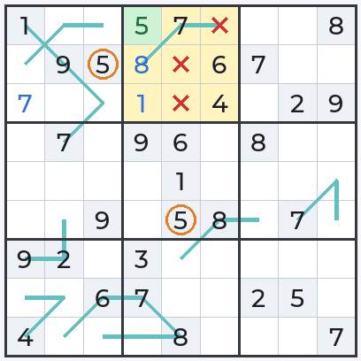

#### Step 5: the 2 in box 2

Box 2 needs a 2. r3c5: row 3 has one (r3c8). r1c6: next to it on its teal line there's one of 1 4 7 and one of 2 5 8 already, and three in a row need one of each. Only **r2c5** is left: **r2c5 = 2**.

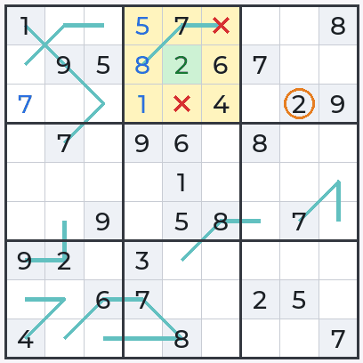

#### Step 6: the 2 in box 1

Box 1 needs a 2. r1c2: column 2 has one (r7c2). r2c1: row 2 has one (r2c5). r3c2 and r3c3: row 3 has one (r3c8). Only **r1c3** is left: **r1c3 = 2**.

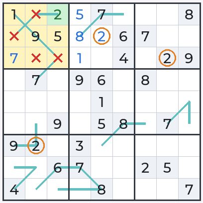

#### Step 7: the 4 in box 1

Box 1 needs a 4. r2c1: column 1 has one (r9c1). r3c2 and r3c3: row 3 has one (r3c6). Only **r1c2** is left: **r1c2 = 4**.

#### Step 8: the 6 in box 1

Box 1 needs a 6. r2c1: row 2 has one (r2c6). r3c3: column 3 has one (r8c3). Only **r3c2** is left: **r3c2 = 6**.

#### Step 9: the 3 in box 1

Box 1 needs a 3. r3c3: next to it on its teal line there's one of 3 6 9 and one of 1 4 7 already, and three in a row need one of each. Only **r2c1** is left: **r2c1 = 3**.

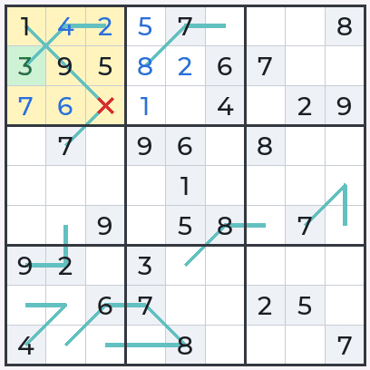

#### Step 10: the 8 in box 1

Box 1 needs an 8, and r3c3 is its last empty cell: **r3c3 = 8**.

#### Step 11: the 9 in box 2

Box 2 needs a 9. r3c5: row 3 has one (r3c9). Only **r1c6** is left: **r1c6 = 9**.

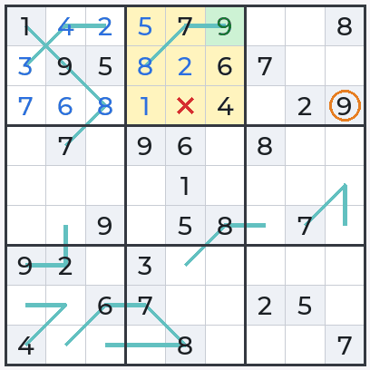

#### Step 12: the 3 in box 2

Box 2 needs a 3, and r3c5 is its last empty cell: **r3c5 = 3**.

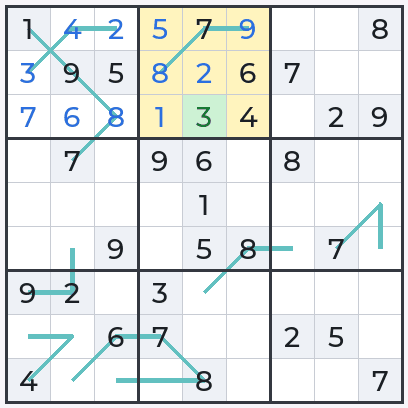

#### Step 13: the 5 in box 3

Box 3 needs a 5. r1c7 and r1c8: row 1 has one (r1c4). r2c8 and r2c9: row 2 has one (r2c3). Only **r3c7** is left: **r3c7 = 5**.

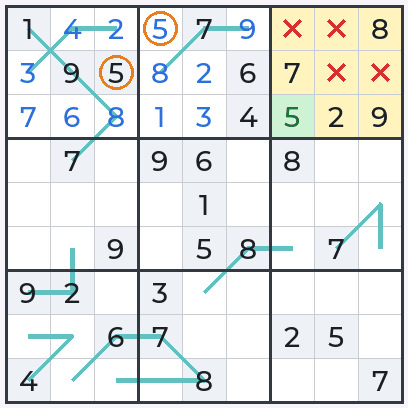

#### Step 14: the 7 in box 5

Box 5 needs a 7. r4c6: row 4 has one (r4c2). r5c4: column 4 has one (r8c4). r6c4: row 6 has one (r6c8). Only **r5c6** is left: **r5c6 = 7**.

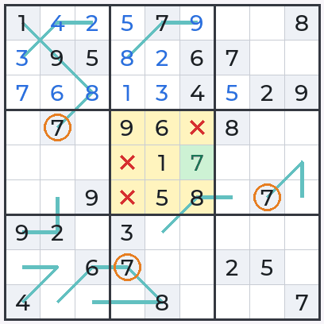

#### Step 15: the 3 in box 5

Box 5 needs a 3. r5c4 and r6c4: column 4 has one (r7c4). Only **r4c6** is left: **r4c6 = 3**.

#### Step 16: the 3 in box 7

Box 7 needs a 3. r7c3: row 7 has one (r7c4). r8c1: column 1 has one (r2c1). r9c2: it's 3 cells from the 8 in r9c5 along its teal line, so it's one of 2 5 8 like it. r9c3: it's 3 cells from the 7 in r8c4 along its teal line, so it's one of 1 4 7 like it. Only **r8c2** is left: **r8c2 = 3**.

#### Step 17: the 3 in box 4

Box 4 needs a 3. r4c1 and r4c3: row 4 has one (r4c6). r5c1 and r6c1: column 1 has one (r2c1). r5c2 and r6c2: column 2 has one (r8c2). Only **r5c3** is left: **r5c3 = 3**.

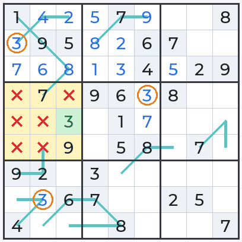

#### Step 18: the 4 in box 4

Box 4 needs a 4. r4c1, r5c1 and r6c1: column 1 has one (r9c1). r5c2 and r6c2: column 2 has one (r1c2). Only **r4c3** is left: **r4c3 = 4**.

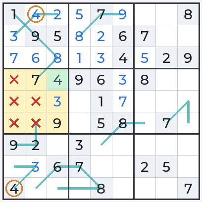

#### Step 19: the 1 in box 4

Box 4 needs a 1. r4c1 and r6c1: column 1 has one (r1c1). r5c1 and r5c2: row 5 has one (r5c5). Only **r6c2** is left: **r6c2 = 1**.

#### Step 20: the 5 in box 7

Box 7 needs a 5. r7c3 and r9c3: column 3 has one (r2c3). r8c1: row 8 has one (r8c8). Only **r9c2** is left: **r9c2 = 5**.

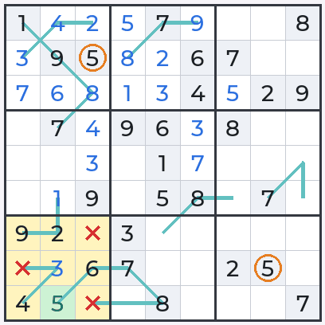

#### Step 21: the 7 in box 7

Box 7 needs a 7. r8c1: row 8 has one (r8c4). r9c3: row 9 has one (r9c9). Only **r7c3** is left: **r7c3 = 7**.

#### Step 22: the 1 in box 7

Box 7 needs a 1. r8c1: column 1 has one (r1c1). Only **r9c3** is left: **r9c3 = 1**.

#### Step 23: the 8 in box 7

Box 7 needs an 8, and r8c1 is its last empty cell: **r8c1 = 8**.

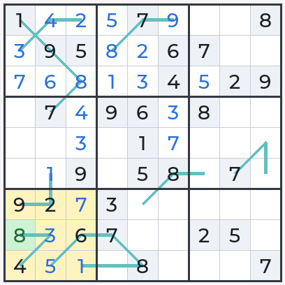

#### Step 24: the 8 in box 4

Box 4 needs an 8. r4c1: row 4 has one (r4c7). r5c1: column 1 has one (r8c1). r6c1: row 6 has one (r6c6). Only **r5c2** is left: **r5c2 = 8**.

#### Step 25: the 2 in box 8

Box 8 needs a 2. r7c5 and r7c6: row 7 has one (r7c2). r8c5 and r8c6: row 8 has one (r8c7). r9c4: it's 3 cells from the 6 in r8c3 along its teal line, so it's one of 3 6 9 like it. Only **r9c6** is left: **r9c6 = 2**.

#### Step 26: the 5 in box 8

Box 8 needs a 5. r7c5: column 5 has one (r6c5). r8c5 and r8c6: row 8 has one (r8c8). r9c4: row 9 has one (r9c2). Only **r7c6** is left: **r7c6 = 5**.

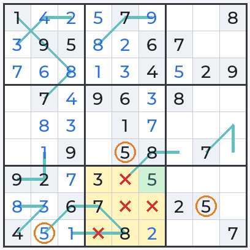

#### Step 27: the 1 in box 8

Box 8 needs a 1. r7c5 and r8c5: column 5 has one (r5c5). r9c4: row 9 has one (r9c3). Only **r8c6** is left: **r8c6 = 1**.

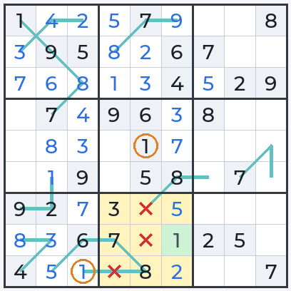

#### Step 28: the 6 in box 8

Box 8 needs a 6. r7c5: column 5 has one (r4c5). r8c5: row 8 has one (r8c3). Only **r9c4** is left: **r9c4 = 6**.

#### Step 29: the 9 in box 8

Box 8 needs a 9. r7c5: row 7 has one (r7c1). Only **r8c5** is left: **r8c5 = 9**.

#### Step 30: the 4 in box 8

Box 8 needs a 4, and r7c5 is its last empty cell: **r7c5 = 4**.

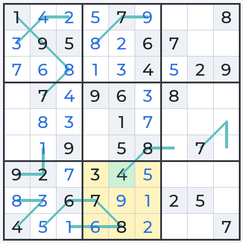

#### Step 31: the 4 in box 9

Box 9 needs a 4. r7c7, r7c8 and r7c9: row 7 has one (r7c5). r9c7 and r9c8: row 9 has one (r9c1). Only **r8c9** is left: **r8c9 = 4**.

#### Step 32: the 4 in box 3

Box 3 needs a 4. r1c7 and r1c8: row 1 has one (r1c2). r2c9: column 9 has one (r8c9). Only **r2c8** is left: **r2c8 = 4**.

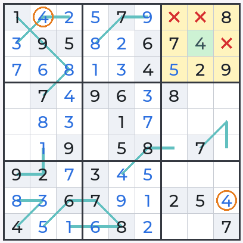

#### Step 33: the 1 in box 3

Box 3 needs a 1. r1c7 and r1c8: row 1 has one (r1c1). Only **r2c9** is left: **r2c9 = 1**.

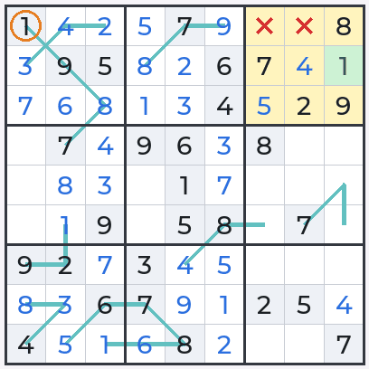

#### Step 34: the 1 in box 6

Box 6 needs a 1. r4c9: column 9 has one (r2c9). r5c7, r5c8 and r5c9: row 5 has one (r5c5). r6c7 and r6c9: row 6 has one (r6c2). Only **r4c8** is left: **r4c8 = 1**.

#### Step 35: the 4 in box 6

Box 6 needs a 4. r4c9: row 4 has one (r4c3). r5c8: column 8 has one (r2c8). r5c9 and r6c9: column 9 has one (r8c9). r6c7: next to it on its teal line there's one of 1 4 7 and one of 2 5 8 already, and three in a row need one of each. Only **r5c7** is left: **r5c7 = 4**.

#### Step 36: the 4 in box 5

Box 5 needs a 4. r5c4: row 5 has one (r5c7). Only **r6c4** is left: **r6c4 = 4**.

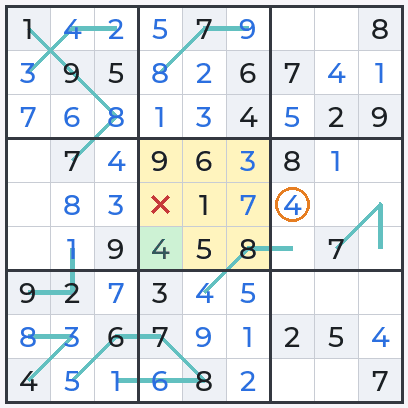

#### Step 37: the 2 in box 5

Box 5 needs a 2, and r5c4 is its last empty cell: **r5c4 = 2**.

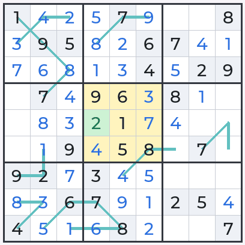

#### Step 38: the 9 in box 6

Box 6 needs a 9. r4c9: row 4 has one (r4c4). r5c9: column 9 has one (r3c9). r6c7 and r6c9: row 6 has one (r6c3). Only **r5c8** is left: **r5c8 = 9**.

#### Step 39: the 1 in box 9

Box 9 needs a 1. r7c8: column 8 has one (r4c8). r7c9: column 9 has one (r2c9). r9c7 and r9c8: row 9 has one (r9c3). Only **r7c7** is left: **r7c7 = 1**.

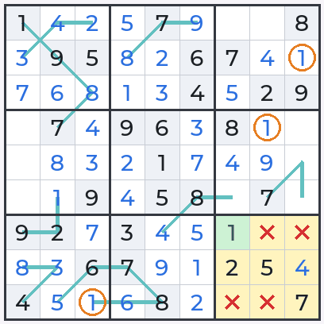

#### Step 40: the 8 in box 9

Box 9 needs an 8. r7c9: column 9 has one (r1c9). r9c7 and r9c8: row 9 has one (r9c5). Only **r7c8** is left: **r7c8 = 8**.

#### Step 41: the 6 in box 9

Box 9 needs a 6. r9c7 and r9c8: row 9 has one (r9c4). Only **r7c9** is left: **r7c9 = 6**.

#### Step 42: the 6 in box 6

Box 6 needs a 6. r4c9: row 4 has one (r4c5). r5c9 and r6c9: column 9 has one (r7c9). Only **r6c7** is left: **r6c7 = 6**.

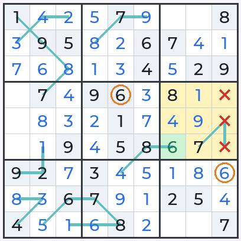

#### Step 43: the 6 in box 3

Box 3 needs a 6. r1c7: column 7 has one (r6c7). Only **r1c8** is left: **r1c8 = 6**.

#### Step 44: the 3 in box 3

Box 3 needs a 3, and r1c7 is its last empty cell: **r1c7 = 3**.

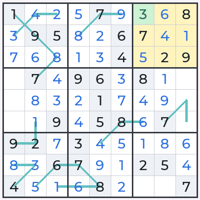

#### Step 45: the 6 in box 4

Box 4 needs a 6. r4c1: row 4 has one (r4c5). r6c1: row 6 has one (r6c7). Only **r5c1** is left: **r5c1 = 6**.

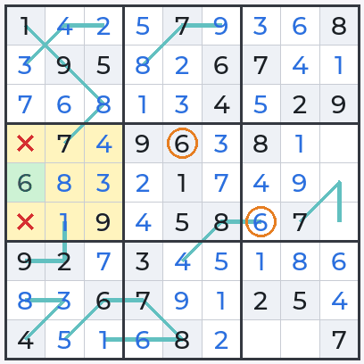

#### Step 46: the 5 in box 4

Box 4 needs a 5. r6c1: row 6 has one (r6c5). Only **r4c1** is left: **r4c1 = 5**.

#### Step 47: the 2 in box 4

Box 4 needs a 2, and r6c1 is its last empty cell: **r6c1 = 2**.

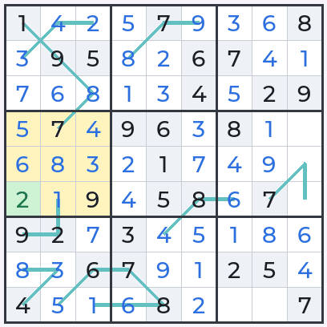

#### Step 48: the 2 in box 6

Box 6 needs a 2. r5c9: row 5 has one (r5c4). r6c9: row 6 has one (r6c1). Only **r4c9** is left: **r4c9 = 2**.

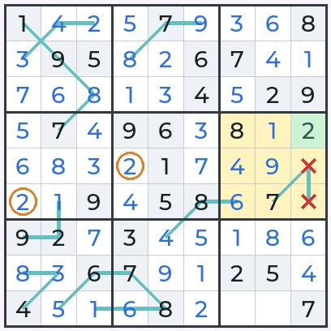

#### Step 49: the 3 in box 6

Box 6 needs a 3. r5c9: row 5 has one (r5c3). Only **r6c9** is left: **r6c9 = 3**.

#### Step 50: the 5 in box 6

Box 6 needs a 5, and r5c9 is its last empty cell: **r5c9 = 5**.

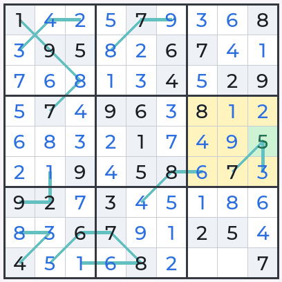

#### Step 51: the 3 in box 9

Box 9 needs a 3. r9c7: column 7 has one (r1c7). Only **r9c8** is left: **r9c8 = 3**.

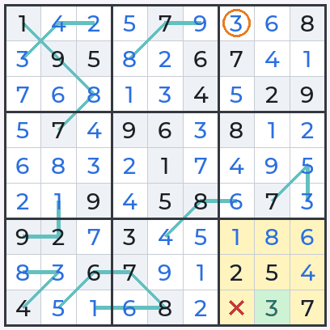

#### Step 52: the 9 in box 9

Box 9 needs a 9, and r9c7 is its last empty cell: **r9c7 = 9**.

Solved.

<!-- /walkthrough -->
