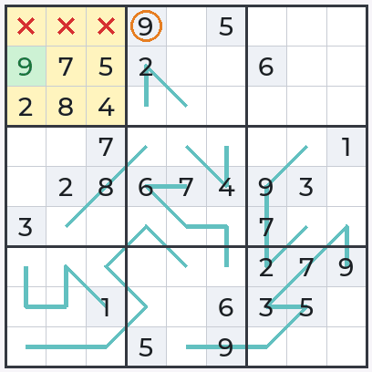

<!-- Written by tools/walkthrough.py modular-lines: edit the script, not this page. -->
# Modular Lines, step 1: the 9 in box 1

**Step 1 of 52** · [← The start](../modular-lines.md#the-whole-puzzle-step-by-step) · [All steps](../modular-lines.md#the-whole-puzzle-step-by-step) · [Step 2 →](step-02.md)

Box 1 needs a 9. r1c1, r1c2 and r1c3: row 1 has one (r1c4). Only **r2c1** is left: **r2c1 = 9**.

**Step 1 of 52** · [← The start](../modular-lines.md#the-whole-puzzle-step-by-step) · [All steps](../modular-lines.md#the-whole-puzzle-step-by-step) · [Step 2 →](step-02.md)
