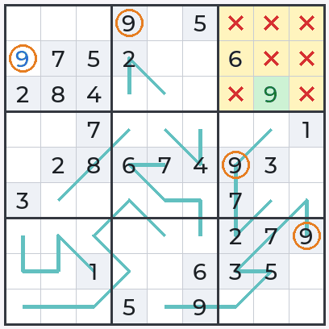

<!-- Written by tools/walkthrough.py modular-lines: edit the script, not this page. -->
# Modular Lines, step 2: the 9 in box 3

**Step 2 of 52** · [← Step 1](step-01.md) · [All steps](../modular-lines.md#the-whole-puzzle-step-by-step) · [Step 3 →](step-03.md)

Box 3 needs a 9. r1c7, r1c8 and r1c9: row 1 has one (r1c4). r2c8 and r2c9: row 2 has one (r2c1). r3c7: column 7 has one (r5c7). r3c9: column 9 has one (r7c9). Only **r3c8** is left: **r3c8 = 9**.

**Step 2 of 52** · [← Step 1](step-01.md) · [All steps](../modular-lines.md#the-whole-puzzle-step-by-step) · [Step 3 →](step-03.md)
