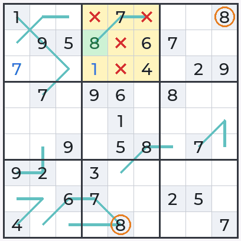

<!-- Written by tools/walkthrough.py modular-lines: edit the script, not this page. -->
# Modular Lines, step 3: the 9 in box 5

**Step 3 of 52** · [← Step 2](step-02.md) · [All steps](../modular-lines.md#the-whole-puzzle-step-by-step) · [Step 4 →](step-04.md)

Box 5 needs a 9. r4c4 and r6c4: column 4 has one (r1c4). r4c6 and r6c6: column 6 has one (r9c6). r6c5: next to it on its teal line there's one of 3 6 9 and one of 1 4 7 already, and three in a row need one of each. Only **r4c5** is left: **r4c5 = 9**.

**Step 3 of 52** · [← Step 2](step-02.md) · [All steps](../modular-lines.md#the-whole-puzzle-step-by-step) · [Step 4 →](step-04.md)
