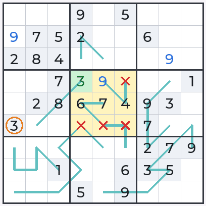

<!-- Written by tools/walkthrough.py modular-lines: edit the script, not this page. -->
# Modular Lines, step 4: the 3 in box 5

**Step 4 of 52** · [← Step 3](step-03.md) · [All steps](../modular-lines.md#the-whole-puzzle-step-by-step) · [Step 5 →](step-05.md)

Box 5 needs a 3. r6c4, r6c5 and r6c6: row 6 has one (r6c1). r4c6: next to it on its teal line there's one of 3 6 9 and one of 1 4 7 already, and three in a row need one of each. Only **r4c4** is left: **r4c4 = 3**.

**Step 4 of 52** · [← Step 3](step-03.md) · [All steps](../modular-lines.md#the-whole-puzzle-step-by-step) · [Step 5 →](step-05.md)
