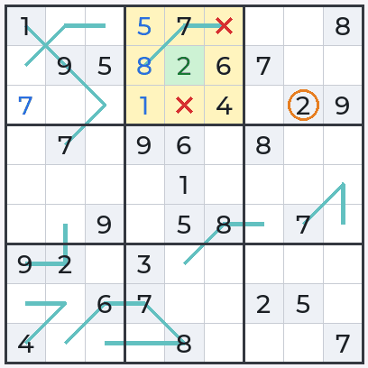

<!-- Written by tools/walkthrough.py modular-lines: edit the script, not this page. -->
# Modular Lines, step 5: the 9 in box 4

**Step 5 of 52** · [← Step 4](step-04.md) · [All steps](../modular-lines.md#the-whole-puzzle-step-by-step) · [Step 6 →](step-06.md)

Box 4 needs a 9. r4c1 and r4c2: row 4 has one (r4c5). r5c1: row 5 has one (r5c7). r6c2: next to it on its teal line there's one of 3 6 9 and one of 2 5 8 already, and three in a row need one of each. Only **r6c3** is left: **r6c3 = 9**.

**Step 5 of 52** · [← Step 4](step-04.md) · [All steps](../modular-lines.md#the-whole-puzzle-step-by-step) · [Step 6 →](step-06.md)
