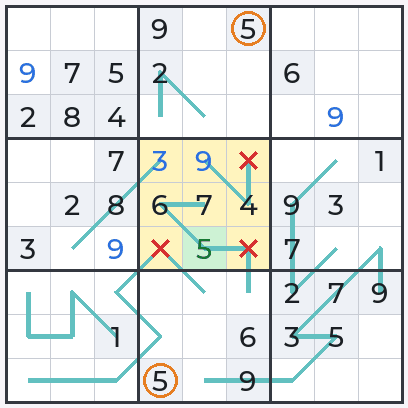

<!-- Written by tools/walkthrough.py modular-lines: edit the script, not this page. -->
# Modular Lines, step 6: the 5 in box 5

**Step 6 of 52** · [← Step 5](step-05.md) · [All steps](../modular-lines.md#the-whole-puzzle-step-by-step) · [Step 7 →](step-07.md)

Box 5 needs a 5. r4c6 and r6c6: column 6 has one (r1c6). r6c4: column 4 has one (r9c4). Only **r6c5** is left: **r6c5 = 5**.

**Step 6 of 52** · [← Step 5](step-05.md) · [All steps](../modular-lines.md#the-whole-puzzle-step-by-step) · [Step 7 →](step-07.md)
