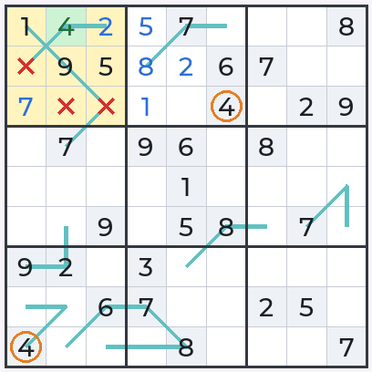

<!-- Written by tools/walkthrough.py modular-lines: edit the script, not this page. -->
# Modular Lines, step 7: the 2 in box 5

**Step 7 of 52** · [← Step 6](step-06.md) · [All steps](../modular-lines.md#the-whole-puzzle-step-by-step) · [Step 8 →](step-08.md)

Box 5 needs a 2. r6c4: column 4 has one (r2c4). r6c6: it's 3 cells from the 7 in r5c5 along its teal line, so it's one of 1 4 7 like it. Only **r4c6** is left: **r4c6 = 2**.

**Step 7 of 52** · [← Step 6](step-06.md) · [All steps](../modular-lines.md#the-whole-puzzle-step-by-step) · [Step 8 →](step-08.md)
