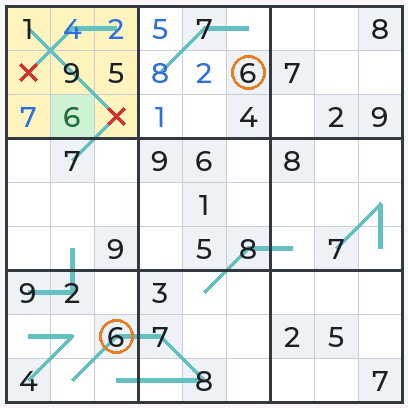

<!-- Written by tools/walkthrough.py modular-lines: edit the script, not this page. -->
# Modular Lines, step 8: the 8 in box 5

**Step 8 of 52** · [← Step 7](step-07.md) · [All steps](../modular-lines.md#the-whole-puzzle-step-by-step) · [Step 9 →](step-09.md)

Box 5 needs an 8. r6c6: it's 3 cells from the 7 in r5c5 along its teal line, so it's one of 1 4 7 like it. Only **r6c4** is left: **r6c4 = 8**.

**Step 8 of 52** · [← Step 7](step-07.md) · [All steps](../modular-lines.md#the-whole-puzzle-step-by-step) · [Step 9 →](step-09.md)
