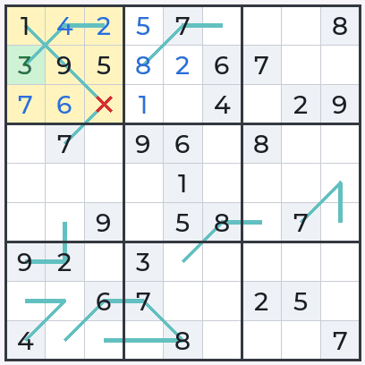

<!-- Written by tools/walkthrough.py modular-lines: edit the script, not this page. -->
# Modular Lines, step 9: the 1 in box 5

**Step 9 of 52** · [← Step 8](step-08.md) · [All steps](../modular-lines.md#the-whole-puzzle-step-by-step) · [Step 10 →](step-10.md)

Box 5 needs a 1, and r6c6 is its last empty cell: **r6c6 = 1**.

**Step 9 of 52** · [← Step 8](step-08.md) · [All steps](../modular-lines.md#the-whole-puzzle-step-by-step) · [Step 10 →](step-10.md)
