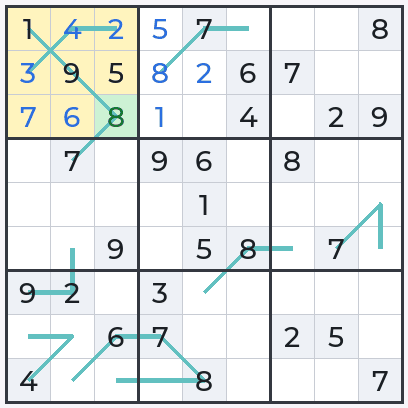

<!-- Written by tools/walkthrough.py modular-lines: edit the script, not this page. -->
# Modular Lines, step 10: the 1 in box 4

**Step 10 of 52** · [← Step 9](step-09.md) · [All steps](../modular-lines.md#the-whole-puzzle-step-by-step) · [Step 11 →](step-11.md)

Box 4 needs a 1. r4c1 and r4c2: row 4 has one (r4c9). r6c2: row 6 has one (r6c6). Only **r5c1** is left: **r5c1 = 1**.

**Step 10 of 52** · [← Step 9](step-09.md) · [All steps](../modular-lines.md#the-whole-puzzle-step-by-step) · [Step 11 →](step-11.md)
