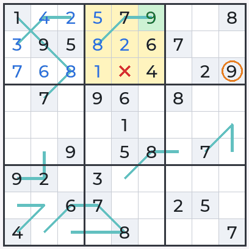

<!-- Written by tools/walkthrough.py modular-lines: edit the script, not this page. -->
# Modular Lines, step 11: the 1 in box 1

**Step 11 of 52** · [← Step 10](step-10.md) · [All steps](../modular-lines.md#the-whole-puzzle-step-by-step) · [Step 12 →](step-12.md)

Box 1 needs a 1. r1c1: column 1 has one (r5c1). r1c3: column 3 has one (r8c3). Only **r1c2** is left: **r1c2 = 1**.

**Step 11 of 52** · [← Step 10](step-10.md) · [All steps](../modular-lines.md#the-whole-puzzle-step-by-step) · [Step 12 →](step-12.md)
