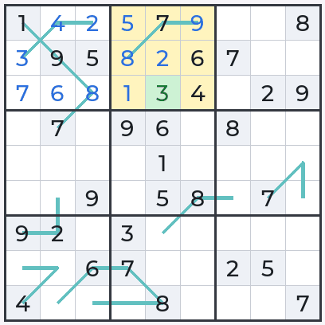

<!-- Written by tools/walkthrough.py modular-lines: edit the script, not this page. -->
# Modular Lines, step 12: the 3 in box 1

**Step 12 of 52** · [← Step 11](step-11.md) · [All steps](../modular-lines.md#the-whole-puzzle-step-by-step) · [Step 13 →](step-13.md)

Box 1 needs a 3. r1c1: column 1 has one (r6c1). Only **r1c3** is left: **r1c3 = 3**.

**Step 12 of 52** · [← Step 11](step-11.md) · [All steps](../modular-lines.md#the-whole-puzzle-step-by-step) · [Step 13 →](step-13.md)
