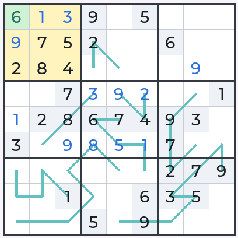

<!-- Written by tools/walkthrough.py modular-lines: edit the script, not this page. -->
# Modular Lines, step 13: the 6 in box 1

**Step 13 of 52** · [← Step 12](step-12.md) · [All steps](../modular-lines.md#the-whole-puzzle-step-by-step) · [Step 14 →](step-14.md)

Box 1 needs a 6, and r1c1 is its last empty cell: **r1c1 = 6**.

**Step 13 of 52** · [← Step 12](step-12.md) · [All steps](../modular-lines.md#the-whole-puzzle-step-by-step) · [Step 14 →](step-14.md)
