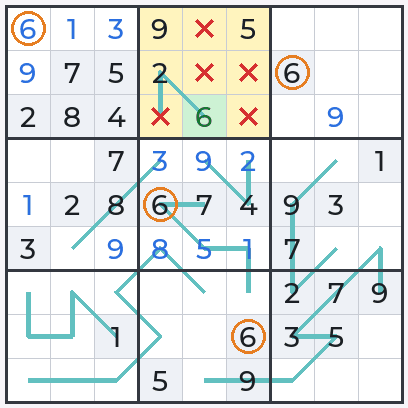

<!-- Written by tools/walkthrough.py modular-lines: edit the script, not this page. -->
# Modular Lines, step 14: the 6 in box 2

**Step 14 of 52** · [← Step 13](step-13.md) · [All steps](../modular-lines.md#the-whole-puzzle-step-by-step) · [Step 15 →](step-15.md)

Box 2 needs a 6. r1c5: row 1 has one (r1c1). r2c5 and r2c6: row 2 has one (r2c7). r3c4: column 4 has one (r5c4). r3c6: column 6 has one (r8c6). Only **r3c5** is left: **r3c5 = 6**.

**Step 14 of 52** · [← Step 13](step-13.md) · [All steps](../modular-lines.md#the-whole-puzzle-step-by-step) · [Step 15 →](step-15.md)
